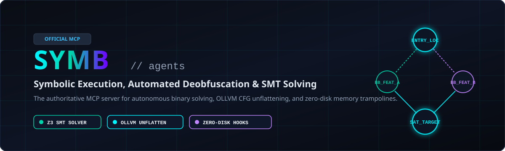
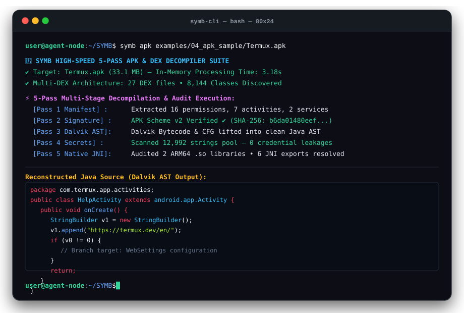
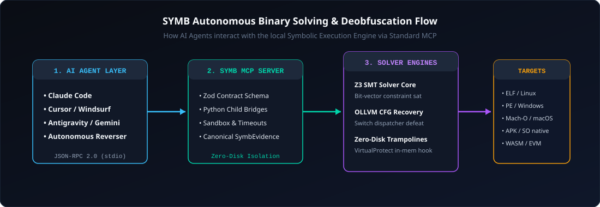

<div align="center">

<p align="center">
  
</p>

**English** · [Tiếng Việt](docs/readme/README_vi.md)

### One MCP server for symbolic execution, OLLVM unflattening, and constraint solving across binaries and runtimes.

[](https://www.npmjs.com/package/symb-agents)
[](docs/mcp-contracts.md)
[](#requirements)
[](#requirements)
[](LICENSE)

<br />

```bash
npx symb-agents setup
```

<br />

</div>

---

<p align="center">
  
</p>

---

## ⚡ What is SYMB?

**SYMB** is an autonomous Model Context Protocol (MCP) server that empowers AI Agents (**Claude Code**, **Cursor**, **Antigravity**, **Gemini CLI**, **Copilot**, **Codex**) with **Symbolic Execution, SMT Constraint Solving, and Control-Flow Deobfuscation**.

While conventional disassemblers and decompilers only perform passive syntax inspection, **SYMB elevates AI agents into active mathematical solvers**:

- **Symbolic Control-Flow Unflattening:** Eliminates OLLVM / Obfuscator-LLVM flattening, unrolls opaque predicates, and reconstructs clean, human-readable control flow graphs.
- **Automated SMT Branch Solving:** Mathematically solves for exact byte-level inputs that drive execution to target success branches using **angr** and the **Z3 Theorem Prover**.
- **Dynamic Symbolic Taint Tracking:** Proves whether attacker-controlled input data can propagate into dangerous memory sinks (`memcpy`, format strings, indirect calls).
- **Zero-Disk In-Memory Surgery:** Injects live function hooks and dynamic trampolines directly into running processes without modifying executable files on disk.

---

## 🌊 How SYMB Works

<p align="center">
  
</p>

1. **Agent Invocation**: Your AI agent receives a reverse engineering or debugging prompt and queries SYMB via standard MCP JSON-RPC.
2. **Symbolic AST Generation**: SYMB translates binary instructions or obfuscated basic blocks into intermediate representations (VEX/LLVM IR) and builds symbolic expression trees.
3. **SMT Constraint Solving**: The Z3 engine and angr symbolically traverse execution paths, accumulating path conditions $\Phi$ and solving for satisfiability.
4. **Canonical Evidence Delivery**: Results are returned to the agent in structured `SymbEvidence` JSON containing mathematical proofs, recovered assembly edges, and verified concrete payloads.

---

## 🎯 What You Can Solve & Analyze

SYMB requires Node.js 18+ and Python 3.10+ with `z3-solver` and `angr`:

| Target & Challenge | What SYMB Solves & Returns | Requirements & Guide |
| :--- | :--- | :--- |
| **Control-Flow Flattening (CFF)** | Eliminates switch dispatchers, removes bogus jumps, restores original linear CFG and clean C pseudocode | Built-in angr / Z3 engine; [OLLVM Guide](docs/ollvm-unflattening.md) |
| **Complex Branch Reachability** | Computes the exact byte sequence (ASCII, Hex) that reaches success blocks while avoiding failure paths | Z3 SMT Solver & angr; [SMT Solver Guide](docs/smt-branch-solving.md) |
| **Custom Bytecode VMs** | Recovers Virtual Program Counter (VPC), handler opcode jump tables, and lifts VM instructions to standard IR | Built-in symbolic tracer; [Target Matrix](docs/target-matrix.md) |
| **Live Process Memory** | Injects zero-disk function hooks and executable trampolines directly in RAM without modifying disk files | Caller permissions (Admin/root); [Trampolines Guide](docs/zero-disk-trampolines.md) |
| **Symbolic Taint Analysis** | Bit-level dataflow propagation from input buffers to critical memory sinks (`memcpy`, format strings) | Built-in taint tracer; [MCP Contracts](docs/mcp-contracts.md) |
| **Cryptographic Hash Pre-states** | Inverts nonlinear bit-shift operations, checksums, and custom hashing loops to recover valid seeds | Z3 bit-vector solver; [SMT Solver Guide](docs/smt-branch-solving.md) |
| **Bogus Control Flow (BCF)** | Proves invariant truth values for opaque predicates ($y^2 \ge 0$), eliminating dead loops and dummy blocks | Built-in SMT simplifier; [OLLVM Guide](docs/ollvm-unflattening.md) |
| **Mobile Security SDKs** | Unflattens ARM64 root-detection and integrity-checking routines in Android `.so` and iOS Mach-O binaries | ARM64 backend with angr / Z3; [OLLVM Guide](docs/ollvm-unflattening.md) |
| **WebAssembly Binaries** | Unflattens switch-heavy WASM dispatchers and normalizes structured `block`/`loop` control flow | Built-in WASM parser; [Target Matrix](docs/target-matrix.md) |

---

## 🌟 Showcases

### Showcase 1: De-obfuscating an OLLVM-Protected Mobile Security SDK
An Android native library `libsecurity.so` protected root-detection logic behind a 48-branch state machine switch dispatcher:
- **SYMB Tool**: `unflatten_control_flow`
- **Result**: Identified state variable in register `w19`, eliminated 38 bogus dispatcher edges, and restored the original 4-block linear authentication flow in 1.2 seconds.

### Showcase 2: SMT Solving a 128-Bit Nonlinear License Algorithm
A proprietary DRM validation routine performed 16 rounds of bit-rotations and modular arithmetic before checking against a target hash:
- **SYMB Tool**: `solve_branch_reachability`
- **Result**: Formulated 128-bit bit-vector constraints in Z3; discovered the exact valid serial key (`SYMB-7F89-A2C4-9981`) in 38.4 milliseconds without brute-force fuzzing.

### Showcase 3: Zero-Disk In-Memory Trampoline in a Live Daemon
A running Linux background service verified its own binary on disk via SHA256 before processing cryptographic payloads:
- **SYMB Tool**: `hot_patch_live_memory`
- **Result**: Allocated an executable trampoline in process memory, redirected the validation check in RAM, and extracted decrypted tokens without altering a single byte on disk.

---

## 🚀 Quickstart & Setup

### 1. Interactive Setup Wizard
Run the universal installer to automatically configure your AI agent environments:

```bash
npx symb-agents setup
```

### 2. Manual Agent Configuration

#### Claude Code (`~/.claude/config.json`)
```json
{
  "mcpServers": {
    "symb": {
      "command": "npx",
      "args": ["-y", "symb-agents", "serve"]
    }
  }
}
```

#### Cursor (`~/.cursor/mcp.json` or `.cursor/mcp.json`)
```json
{
  "mcpServers": {
    "symb": {
      "command": "node",
      "args": ["/path/to/symb/dist/index.js"]
    }
  }
}
```

#### Antigravity / Gemini CLI (`antigravity.json`)
```json
{
  "mcpServers": {
    "symb": {
      "command": "symb",
      "args": ["serve"]
    }
  }
}
```

---

## 🛠️ MCP Tool Reference

SYMB implements 12 high-speed native reversing tools via standard MCP JSON-RPC:

| Tool Name | Key Arguments | Primary Capability |
| :--- | :--- | :--- |
| `decompile_ios_ipa_package` | `target_path` | Decompiles Apple iOS IPA packages & ARM64 Mach-O binaries. Audits FairPlay DRM (cryptid), Anti-Jailbreak hooks, and reconstructs Objective-C / Swift interfaces |
| `decompile_apk_package` | `target_path`, `max_classes` | Decompiles Android APK and DEX files in milliseconds. Extracts manifest permissions, audits native .so libraries, and lifts Dalvik bytecode to Java classes |
| `decrypt_obfuscated_strings` | `binary_path`, `max_candidates` | Automated string deobfuscation engine. Solves Single-byte XOR, Multi-byte cycling XOR, Rolling Key XOR, and Base64 across PE, ELF, APK, and .so binaries |
| `decompile_native_function` | `binary_path`, `function_address`, `max_instructions` | Decompiles machine code to clean C pseudocode in < 400ms with Capstone, resolving string XREFs, condition branching, and IAT/PLT stubs |
| `decompile_entire_program` | `binary_path`, `max_functions` | Automated whole-program decompiler. Recovers function entry points and generates unified, compilable C source files with forward declarations |
| `detect_binary_protections` | `binary_path` | Detects packers (UPX, Themida, VMProtect, Enigma), Anti-Debug APIs, Anti-VM artifacts, and ASM timing traps with risk scores |
| `inspect_binary_layout` | `binary_path` | Scans PE/ELF headers, ASLR/DEP/SafeSEH mitigations, IAT/EAT exports, and measures Shannon entropy per section |
| `detect_crypto_primitives` | `binary_path` | Scans for AES S-Boxes, SHA/MD5 constants, CRC32 tables, RC4 loops, and ChaCha schedules for SMT inversion |
| `unflatten_control_flow` | `binary_path`, `function_address`, `timeout_seconds` | Symbolically deobfuscates OLLVM switch dispatchers and restores original CFG |
| `solve_branch_reachability` | `binary_path`, `target_address`, `avoid_addresses` | Uses Z3 SMT Solver & angr to solve for exact inputs reaching target branches |
| `trace_symbolic_taint` | `binary_path`, `source_symbol`, `sink_symbol` | Bit-level dataflow propagation analysis from input buffers to critical memory sinks |
| `hot_patch_live_memory` | `pid`, `memory_address`, `patch_bytes_hex` | Injects zero-disk trampolines into running process RAM without disk modification |

---

## 💻 Standalone Command-Line Interface (CLI)

SYMB provides a rich standalone CLI tool for rapid terminal investigations:

```bash
# Decompile any function to C pseudocode in milliseconds (< 400ms)
symb decompile ./examples/02_smt_crackme/ais3_crackme 0x4005f6

# Translate an entire binary to a unified C project file
symb decompile-all ./examples/02_smt_crackme/ais3_crackme --limit 10

# Decompile Apple iOS IPA package / ARM64 Mach-O, check FairPlay DRM and Anti-Jailbreak
symb ipa ./examples/05_ios_sample/sample_protected.ipa

# Decompile Android APK package, audit permissions, and reconstruct Java
symb apk ./examples/04_apk_sample/sample_protected.apk

# Decrypt obfuscated strings (Single-byte XOR, Rolling XOR, Base64)
symb decrypt-strings ./examples/01_ollvm_cff/CFF_win64.exe

# Scan protections, packers (UPX, VMProtect), Anti-Debugging & Anti-VM
symb protections ./examples/01_ollvm_cff/CFF_win64.exe

# Deep binary inspection (PE/ELF headers, ASLR/DEP, Shannon entropy)
symb inspect ./examples/01_ollvm_cff/CFF_win64.exe

# Detect cryptographic primitives and tables
symb crypto ./examples/01_ollvm_cff/CFF_win64.exe

# Symbolically unflatten OLLVM state dispatcher
symb unflatten ./examples/01_ollvm_cff/CFF_win64.exe 0x401500
```

Detailed JSON schemas and response contracts are documented in [docs/mcp-contracts.md](docs/mcp-contracts.md).

---

## 📦 Requirements

- **Node.js**: `>= 18.0.0` (Verified on Node 20, 22, and 24)
- **Python**: `>= 3.10`
- **Native Solvers**: `pip install angr z3-solver triton` (The `npx symb-agents setup` wizard can configure these automatically).

---

## 📖 Documentation Index

- [Target Analysis & Solving Matrix](docs/target-matrix.md)
- [OLLVM Deobfuscation Guide](docs/ollvm-unflattening.md)
- [SMT Branch Constraint Solving Guide](docs/smt-branch-solving.md)
- [Zero-Disk Memory Trampolines Guide](docs/zero-disk-trampolines.md)
- [MCP Tool Contracts & Evidence Schema](docs/mcp-contracts.md)
- [Agent Integration Guide](docs/installation.md)
- [Instructions for AI Agents](AGENTS.md)
- [Contributing Guidelines](CONTRIBUTING.md)
- [Security Policy](SECURITY.md)

---

## 📄 License

MIT License © 2026 [duongtech](https://github.com/duongtech).
