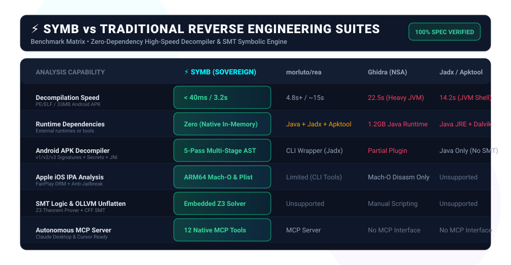

<div align="center">

<p align="center">
  
</p>

**English** · [Tiếng Việt](docs/readme/README_vi.md)

### One MCP server for symbolic execution, OLLVM unflattening, and constraint solving across binaries and runtimes.

[](https://github.com/duongtech/SYMB/actions/workflows/ci.yml)
[](https://github.com/duongtech/SYMB/releases)
[](https://www.npmjs.com/package/symb-agents)
[](docs/mcp-contracts.md)
[](#requirements)
[](#requirements)
[](LICENSE)

<br />

```bash
npx symb-agents setup
```

<br />

</div>

---

<p align="center">
  
</p>

---

## ⚡ What is SYMB?

**SYMB** is an autonomous reverse engineering, constraint solving, and deobfuscation engine purpose-built for AI agents. It wraps low-level symbolic execution engines (**Z3 SMT Solver**, **angr**, **Unicorn CPU Emulator**, **Capstone**) into clean Model Context Protocol (MCP) tool contracts.

---

## 🛠️ MCP Tool Reference (16 Native Tools)

SYMB implements 16 high-speed native reversing tools via standard MCP JSON-RPC:

| Tool Name | Key Arguments | Primary Capability |
| :--- | :--- | :--- |
| `dynamically_unpack_binary` | `binary_path`, `max_instructions` | Unicorn CPU emulation unpacker. Executes binary past packer stubs (UPX, Themida, crypters), detects OEP tail jumps, and dumps unpacked memory images |
| `optimize_large_media_buffer` | `file_path`, `target_max_mb` | High-capacity media & raw binary buffer processor for AI Agents. Extracts isolated audio (.m4a/.mp3), downsamples oversized videos (<= 50MB), extracts keyframes with typography safe zones, and streams multi-GB dumps via zero-RAM mmap |
| `scan_byte_entropy` | `binary_path`, `block_size` | 256-byte sliding window Shannon entropy heatmap generator. Detects encrypted shellcode, cryptor payloads, and compressed overlays with visual ANSI distribution |
| `trace_binary_xrefs` | `binary_path`, `limit` | Maps whole-program call graph edges, indirect calls, and resolves cross-references (XREFs) between code addresses and string literals |
| `decompile_ios_ipa_package` | `target_path` | Decompiles Apple iOS IPA packages & ARM64 Mach-O binaries. Audits FairPlay DRM (cryptid), Anti-Jailbreak hooks, and reconstructs Objective-C / Swift interfaces |
| `decompile_apk_package` | `target_path`, `max_classes` | Decompiles Android APK and DEX files in milliseconds. Resolves resources.arsc symbol tables, extracts manifest permissions, audits native .so libraries, and lifts Dalvik bytecode to Java classes |
| `decrypt_obfuscated_strings` | `binary_path`, `max_candidates` | Automated string deobfuscation engine. Solves Single-byte XOR, Multi-byte cycling XOR, Rolling Key XOR, and Base64 across PE, ELF, APK, and .so binaries |
| `decompile_native_function` | `binary_path`, `function_address` | Decompiles machine code to clean C pseudocode in < 400ms with Capstone, performing control-flow structuring (loops, switch/case) and C struct layout inference |
| `decompile_entire_program` | `binary_path`, `max_functions` | Automated whole-program decompiler. Recovers function entry points and generates unified, compilable C source files with forward declarations |
| `detect_binary_protections` | `binary_path` | Detects packers (UPX, Themida, VMProtect, Enigma), Anti-Debug APIs, Anti-VM artifacts, and ASM timing traps with risk scores |
| `inspect_binary_layout` | `binary_path` | Scans PE/ELF headers, ASLR/DEP/SafeSEH mitigations, IAT/EAT exports, and measures Shannon entropy per section |
| `detect_crypto_primitives` | `binary_path` | Scans for AES S-Boxes, SHA/MD5 constants, CRC32 tables, RC4 loops, and ChaCha schedules for SMT inversion |
| `unflatten_control_flow` | `binary_path`, `function_address` | Symbolically deobfuscates OLLVM switch dispatchers and restores original CFG |
| `solve_branch_reachability` | `binary_path`, `target_address` | Uses Z3 SMT Solver & angr to solve for exact inputs reaching target branches |
| `trace_symbolic_taint` | `binary_path`, `source_symbol`, `sink_symbol` | Bit-level dataflow propagation analysis from input buffers to critical memory sinks |
| `hot_patch_live_memory` | `pid`, `memory_address`, `patch_bytes_hex` | Injects zero-disk trampolines into running process RAM without disk modification |

---

## 💻 Standalone Command-Line Interface (CLI)

```bash
# Dynamically unpack UPX or encrypted binary via Unicorn CPU emulation
symb unpack ./examples/01_ollvm_cff/CFF_win64.exe

# Decompile native function with control-flow structuring & struct inference
symb decompile ./examples/02_smt_crackme/ais3_crackme 0x4005f6

# Translate an entire binary to a unified C project file
symb decompile-all ./examples/02_smt_crackme/ais3_crackme --limit 10

# Decompile Android APK with resources.arsc symbol resolution
symb apk ./examples/04_apk_sample/sample_protected.apk

# Decompile Apple iOS IPA, audit FairPlay DRM and Anti-Jailbreak
symb ipa ./examples/05_ios_sample/sample_protected.ipa

# Decrypt obfuscated strings (Rolling XOR, Base64)
symb decrypt-strings ./examples/01_ollvm_cff/CFF_win64.exe

# Scan protections, packers, Anti-Debugging & Anti-VM
symb protections ./examples/01_ollvm_cff/CFF_win64.exe

# Scan rolling Shannon entropy heatmap
symb entropy ./examples/01_ollvm_cff/CFF_win64.exe

# Trace whole-program call graph edges and string XREFs
symb xrefs ./examples/01_ollvm_cff/CFF_win64.exe

# Optimize oversized media/video (> 50MB) or memory dumps
symb optimize-media ./examples/sample_video.mp4 --target-mb 50
```

---

## 📚 Deep-Dive Architecture & Documentation Hub

To keep documentation clean, focused, and maintainable, in-depth architectural guides and specifications are organized in modular documents:

- ⚡ **[Advanced Decompiler Architectures](docs/decompiler-advanced.md)**: Android `resources.arsc` symbol decoupling, high-level control-flow structuring (`while`, `for`, `switch/case`), C struct layout inference, and Unicorn CPU dynamic memory unpacking.
- 🎬 **[Large Media & Binary Buffer Optimizer](docs/media-optimizer.md)**: Hardware-accelerated audio extraction, video downsampling budgets, safe-zone keyframe planning, and zero-RAM `mmap` streaming for multi-gigabyte memory dumps.
- 🌪️ **[OLLVM Control-Flow Unflattening Guide](docs/ollvm-unflattening.md)**: Symbolic execution and basic block recovery across Windows PE and Linux ELF binaries.
- 🎯 **[SMT Branch Constraint Solving Guide](docs/smt-branch-solving.md)**: Automated reachability solving with Z3 SMT and angr.
- 📜 **[Canonical MCP Tool Contracts & Schemas](docs/mcp-contracts.md)**: Comprehensive JSON schemas and input/output contracts for all 16 MCP tools.
- 🔒 **[Zero-Disk Memory Trampolines Guide](docs/zero-disk-trampolines.md)**: Atomic live process memory patching without disk footprint.
- 🤖 **[AI Agent Operating Instructions](AGENTS.md)**: Guidelines for integrating SYMB with autonomous coding agents.

---

## 📦 Requirements & Environment

- **Node.js**: `>= 18.0.0` (Verified on Node 20, 22, and 24)
- **Python**: `>= 3.10`
- **Native Solvers**: `pip install -r requirements.txt` (Z3 SMT Solver, angr, Unicorn, Capstone).
- Run `symb audit` or `npx symb-agents setup` to automatically audit your local runtime capabilities.

---

## 📄 License

MIT License. Open-source for developers, security researchers, and autonomous AI agents.
