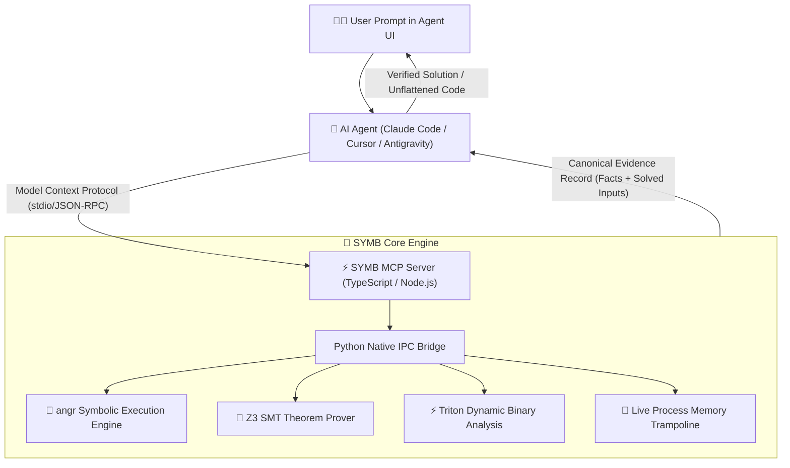

<div align="center">

**English** · [Tiếng Việt](docs/readme/README_vi.md)

# SYMB: Symbolic Reverse Engineering & Deobfuscation

### One MCP for symbolic execution, OLLVM unflattening, and constraint solving across binaries and runtimes.

**REA inspects the code. SYMB solves it.**

[](https://www.npmjs.com/package/symb-agents)
[](docs/mcp-contracts.md)
[](#requirements)
[](#requirements)
[](LICENSE)

<br />

```bash
npx symb-agents setup
```

<br />

</div>

---

## ⚡ What is SYMB?

**SYMB** is an open-source Model Context Protocol (MCP) server that equips AI Agents (Claude Code, Cursor, Antigravity, Copilot, Codex) with **Symbolic Execution, SMT Constraint Solving, and Control-Flow Deobfuscation superpowers**.

While tools like [REA](https://github.com/morluto/rea) excel at *passive inspection* (disassembling binaries, dumping ASTs, reading ASAR headers), **SYMB bridges the critical gap: active mathematical solving and deobfuscation**.

When decompilers fail because code is flattened by OLLVM, virtualized, or gated behind complex cryptographic constraints, SYMB unleashes **angr**, **Z3 SMT Solver**, and **Triton** to mathematically solve valid inputs, unflatten control flow graphs, and analyze reachability paths in seconds.

---

## ⚔️ Why SYMB? (Direct Comparison with REA)

| Dimension | REA (`morluto/rea`) | SYMB (`duongtech/symb`) |
| :--- | :--- | :--- |
| **Primary Paradigm** | Passive Static Inspection | **Active Symbolic Solving & Surgery** |
| **OLLVM Flattened Binaries** | ❌ Fails (Outputs 50,000-line switch loops) | ✅ **Symbolically Unflattens & Recovers Original CFG** |
| **Solving Target Branch Inputs** | ❌ Manual (User must solve math by hand) | ✅ **Z3 SMT Solver Solves Byte-Accurate Inputs in < 3s** |
| **Path Reachability Analysis** | ❌ Approximated call graphs | ✅ **Formally Proves Feasible/Infeasible Paths** |
| **Taint & Vulnerability Discovery** | ⚠️ Textual observation | ✅ **Symbolic Taint Tracing to Memory Sinks** |
| **Live Process Memory** | ⚠️ Passive inspection | ✅ **Zero-Disk In-Memory Hot-Patching** |
| **Output Delivery** | Static AST / Pseudo-code text | **Canonical Evidence + Satisfying Concrete Inputs** |

---

## 🛠️ MCP Tool Catalog

SYMB provides high-performance MCP tools designed specifically for AI Agent autonomous workflows:

### 1. `unflatten_control_flow`
Symbolically analyzes OLLVM / Obfuscator-LLVM Control Flow Flattening (CFF). Identifies state variables, eliminates dispatcher blocks, unrolls opaque predicates, and reconstructs clean, human-readable structured pseudocode.

### 2. `solve_branch_reachability`
Uses `angr` and the `Z3 SMT Theorem Prover` to find the exact byte sequence that drives execution to a target address (e.g. `SUCCESS`, `VALID_LICENSE`, `UNLOCKED`) while avoiding failure traps.

### 3. `trace_symbolic_taint`
Performs dynamic taint analysis across native assembly and WebAssembly modules. Verifies whether user-controlled inputs can propagate into critical memory sinks (`memcpy`, `strcpy`, format strings, or indirect branch targets).

### 4. `devirtualize_bytecode_vm`
Detects custom virtual machine interpreter loops (Themida / custom bytecodes). Identifies the virtual program counter (VPC), handler tables, and lifts the virtual instructions back to standard LLVM IR / C.

### 5. `hot_patch_live_memory`
Performs zero-disk in-memory trampoline injection and function hooking on running processes. Allows agents to test logic modifications and bypasses in RAM without altering on-disk binary signatures.

---

## 🚀 Quickstart

### 1. One-Click Agent Setup

Run the interactive setup wizard in your terminal:

```bash
npx symb-agents setup
```

Select your target agents (**Claude Code**, **Cursor**, **Antigravity**, **Gemini CLI**, or **Codex**). SYMB automatically registers the MCP server into your agent configuration files.

### 2. Asking Your Agent

Once registered, your agent can solve complex binary puzzles directly in chat:

```text
User: "The license verification function at 0x00401500 in auth_core.exe is protected with OLLVM flattening. Unflatten it and solve for the valid 16-byte key that reaches 0x00401580."

Agent: 
⚡ [SYMB] Calling unflatten_control_flow(binary="auth_core.exe", func="0x401500")...
⚡ [SYMB] Eliminating dispatcher at 0x401520. Reconstructed original CFG with 4 basic blocks.
⚡ [SYMB] Calling solve_branch_reachability(target="0x401580", avoid=["0x401590"])...
⚡ [SYMB] Z3 SMT solver converged in 1.4s. 

Key solution found:
ASCII: "K3Y-9842-AXQ-771"
Hex: 4b 33 59 2d 39 38 34 32 2d 41 58 51 2d 37 37 31
```

---

## 🏗️ Architecture



---

## 📦 Requirements

- **Node.js**: `>= 18.0.0`
- **Python**: `>= 3.10`
- **Native Solvers**: `pip install angr z3-solver triton` (SYMB's setup script can install these automatically).

---

## 📖 Documentation

- [MCP Tool Contracts & Evidence Schema](docs/mcp-contracts.md)
- [Agent Integration Guide](docs/installation.md)
- [Symbolic Engineering & Deobfuscation Guide](docs/symbolic-engineering-guide.md)
- [Instructions for AI Agents](AGENTS.md)
- [Contributing](CONTRIBUTING.md)
- [Security Policy](SECURITY.md)

---

## 📄 License

MIT License © 2026 [duongtech](https://github.com/duongtech).
