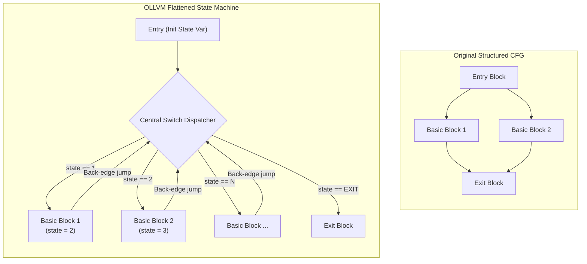

# OLLVM Control-Flow Flattening (CFF) Deobfuscation Guide

Control Flow Flattening (CFF), popularized by Obfuscator-LLVM (OLLVM), Hikari, Goron, and Tigress, transforms a program's structured control flow (if/else, loops) into a flat state machine controlled by a central switch dispatcher.



---

## 🔬 How SYMB Unflattens CFF

SYMB operates via symbolic execution and AST analysis without requiring manual IDA/Ghidra script writing:

### 1. State Variable Identification
SYMB scans the loop header for conditional jump targets dependent on a single memory slot or register (e.g. `[rbp - 0x18]` or `w0`).

### 2. Basic Block Extraction
Blocks that mutate the state variable and jump back to the dispatcher are tagged as **relevant basic blocks**. Dispatcher nodes and bogus pre-dispatch checks are tagged as **obfuscation scaffolding**.

### 3. Symbolic Execution of Dispatch Transitions
For each basic block $B_i$:
- SYMB executes instructions symbolically using angr / Z3.
- Evaluates the state variable expression after $B_i$ finishes.
- Identifies the target successor block $B_j = \text{Target}(\text{state\_val})$.

### 4. Direct Edge Patching & Clean CFG Synthesis
- Replaces the indirect jumps back to the central dispatcher with direct jumps (`jmp B_j` or conditional `jcc B_k, B_j`).
- Unrolls opaque predicates (e.g. $y^2 \ge 0 \implies \text{always true}$).
- Produces normalized, decompilable C pseudocode and DOT graph representations.

---

## 🛠️ MCP Tool: `unflatten_control_flow`

### Input Parameters
```json
{
  "binary_path": "libnative_auth.so",
  "function_address": "0x000412A0",
  "arch": "arm64",
  "output_format": "c_pseudocode"
}
```

### Returns (`SymbEvidence`)
- `status`: `"SUCCESS"`
- `confidence`: `0.98`
- `recovered_edges`: List of `[from_addr, to_addr, condition]`
- `synthesized_code`: Cleaned de-flattened C code
- `dot_graph`: Visual CFG for Graphviz / Mermaid.
