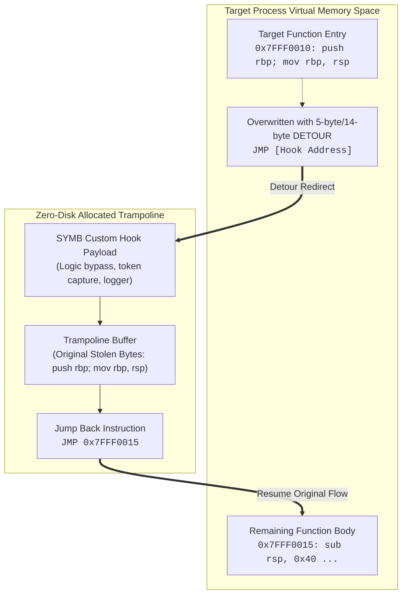

# Zero-Disk Dynamic Memory Trampolines & In-Memory Hooks

When analyzing anti-tamper systems, binary integrity verifiers, or live game and enterprise daemons, modifying the executable file on disk triggers checksum alarms (e.g. Authenticode signature mismatch, VAC, BattleEye, or self-hashing checks).

**SYMB provides Zero-Disk In-Memory Hot-Patching via Trampolines**:

---

## 💉 Mechanics of Zero-Disk Trampolines



1. **Virtual Memory Permission Management**:
   - Windows: Calls `VirtualProtect(address, size, PAGE_EXECUTE_READWRITE, &oldProtect)`.
   - Linux: Calls `mprotect(aligned_addr, size, PROT_READ | PROT_WRITE | PROT_EXEC)`.
2. **Stolen Bytes Preservation**:
   Extracts leading instructions and relocates them into a dedicated executable trampoline buffer.
3. **Atomic Jump Detour**:
   Writes an absolute 64-bit indirect jump (`FF 25 00 00 00 00 [64-bit pointer]`) or 32-bit relative jump (`E9 [relative_offset]`).
4. **Zero-Disk Integrity**:
   The disk image remains 100% authentic. All operations take place strictly within the running process virtual address space.

---

## 🛠️ MCP Tool: `hot_patch_live_memory`

### Input Parameters
```json
{
  "target_pid": 4820,
  "hook_address": "0x7FFF0024A100",
  "patch_bytes_hex": "4831C048FFC0C3",
  "method": "trampoline_detour"
}
```

### Result:
- Injects trampoline safely.
- Returns previous bytes for instant clean rollback.
- Confirms execution diversion.
